# RV Car Studio

A car editor for [Re-Volt](https://re-volt.gitlab.io/rvgl-docs/) / RVGL. You work on the car directly in the 3D view: its
shape, paint, shading, collision, handling and menu entry, up to the zip you share.

By Kallel A.Y (theKDL). GPL v3.

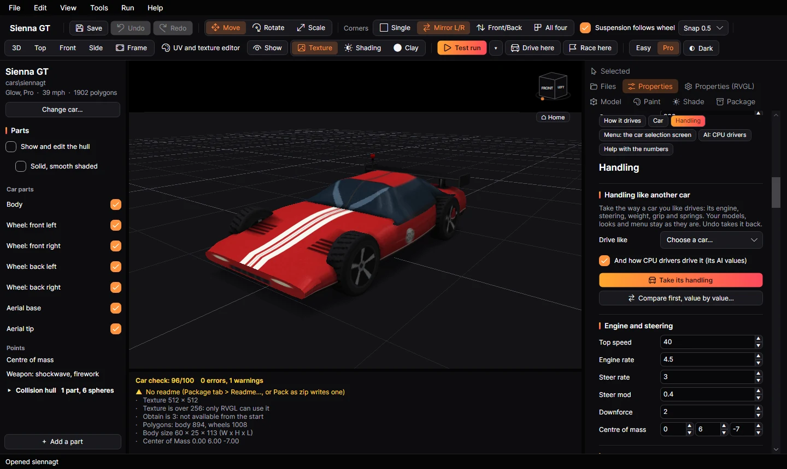

## Download

**[Latest release](https://github.com/kallelay/RV-Car-Studio/releases/latest)**: unpack and run, nothing to install. It asks
for your RVGL folder (the one holding `cars`) the first time.

| System | |
|---|---|
| Windows, 64-bit | `RvCarStudio-…-win-x64.zip` |
| Linux, 64-bit | `RvCarStudio-…-linux-x64.tar.gz`, tested on Ubuntu 24.04 |
| macOS | builds from source, not tested on a Mac yet |

**[Documentation](docs/index.html)** is in the download too, as `docs/index.html` (Help > Documentation).

## What it does

**Two ways to work.** *Pro* shows everything, RVGL's own values too. *Easy* has the layout of the old RV Car Studio.

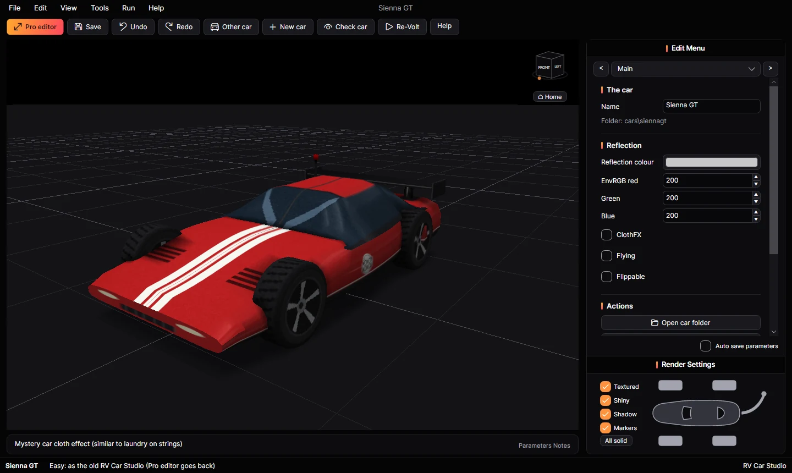

**Paint**: hue, colour swaps and whole-car colours seen live, skins, and a UV and texture editor with brushes, shapes and
generators.

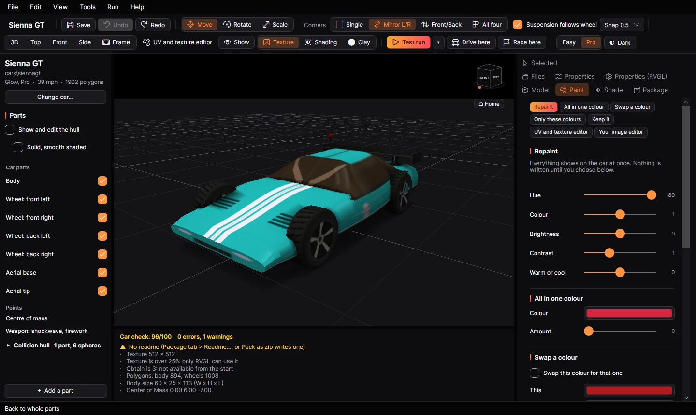

| | |
|---|---|
| 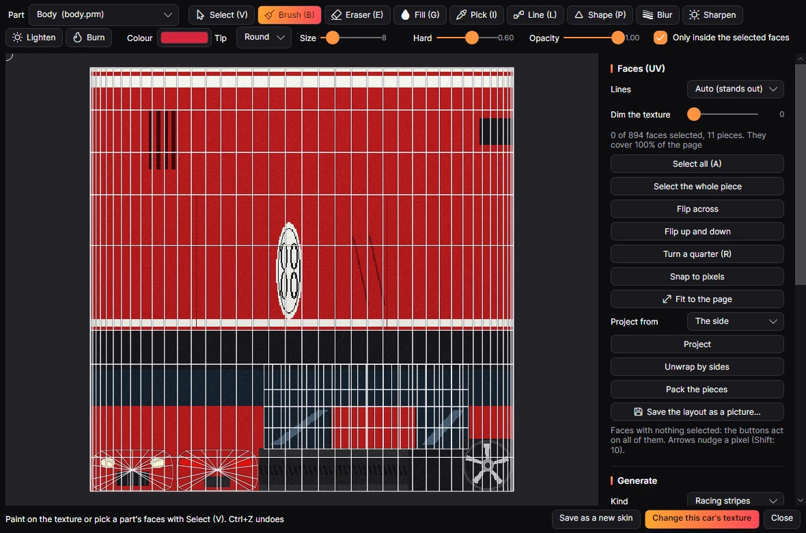 | 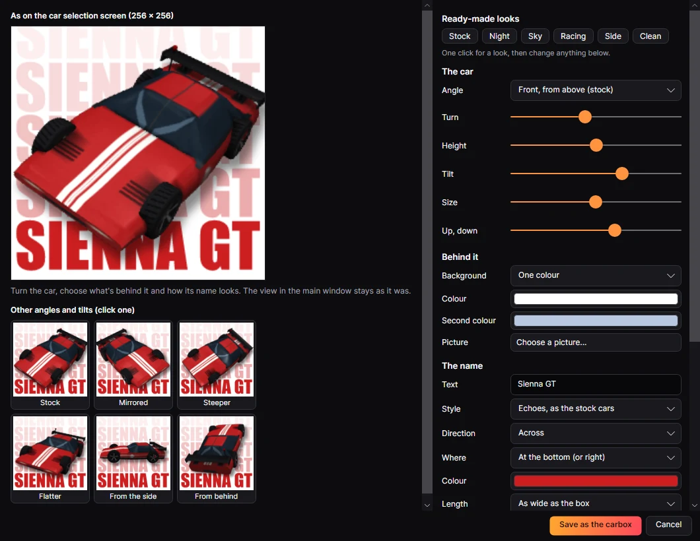 |
| UV and texture editor | Carbox maker |
| 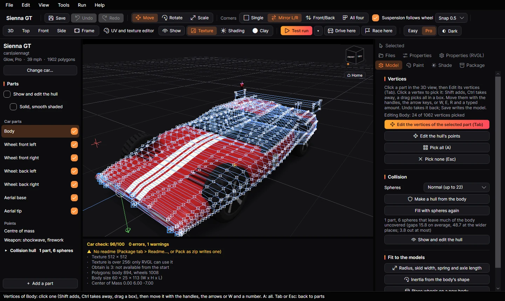 | 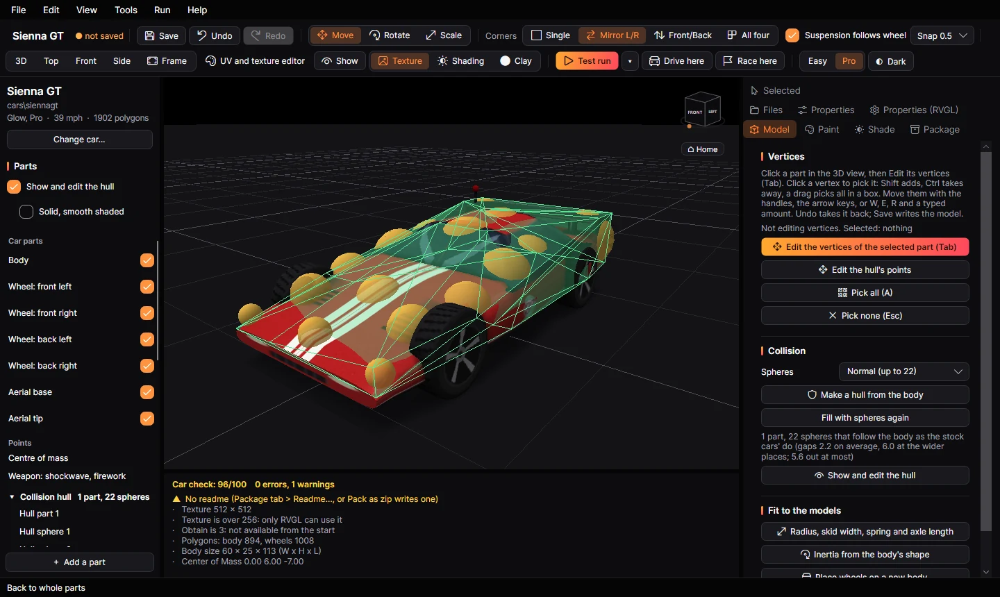 |
| Vertices of models and hulls | A hull fitted to the body |
| 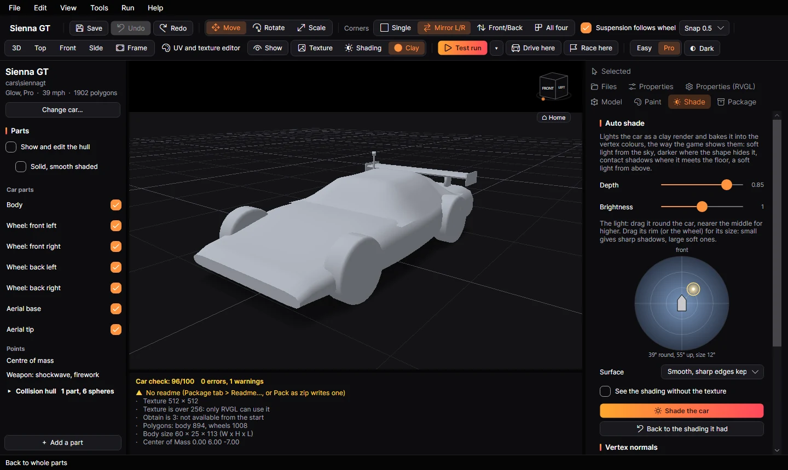 | 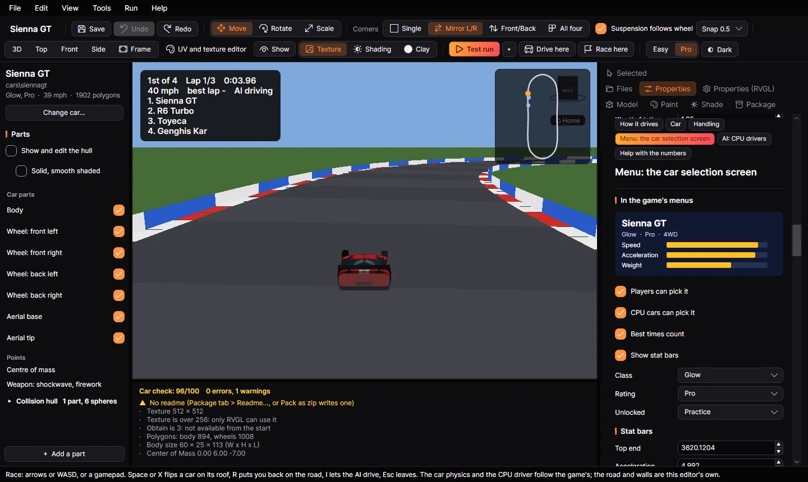 |
| Light and shade baked in | Race against CPU cars, right here |
| 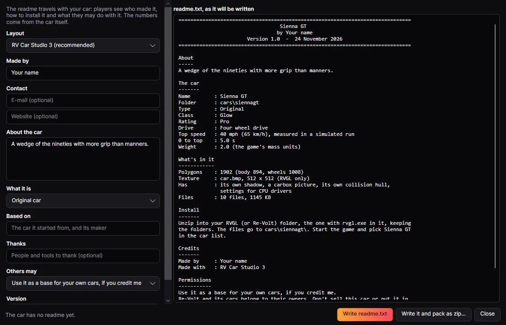 | 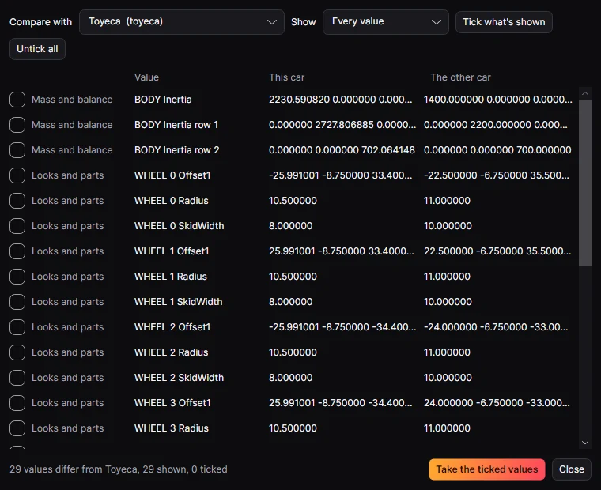 |
| Readme generator | Compare with another car |

- **New car**: a repaint, a remodel, or your own body, wheel and texture (`.prm` or `.obj`), with tours that point at what to click
- **Handling** worked out as you edit, or taken from a car you like; try it with the original game's physics or in RVGL (F5)
- **Auto shade, shadow, carbox, hull, readme, zip**: one click each
- **Safe**: the game's own files stay as they are (changes to a stock car go to `packs\local`), only changed lines are rewritten,
  the first version of each file is kept as `.bak`, and there's undo

## Building

.NET 10 SDK:

    dotnet run --project Studio/RvStudio.App -- -rvpath "D:\ReVolt"

More in [Studio/README.md](Studio/README.md). The packages are made by `Studio/tools/package.ps1`.

## The old RV Car Studio

Version 2 (VB.NET, Windows Forms, OpenTK, .NET Framework 4.8) is still here, in `RvCarStudio`: open `RvCarStudio.sln` in Visual
Studio, or `MSBuild RvCarStudio.sln /p:Configuration=Debug`. Version 3 in `Studio` is written again from the start.

## Licence

GPL v3, see [LICENSE](LICENSE). Libraries: [Studio/THIRD_PARTY.md](Studio/THIRD_PARTY.md). Re-Volt is the property of its owners;
RVGL is the work of the RVGL team. No game data is included. The car in the pictures is the author's Sienna GT.
